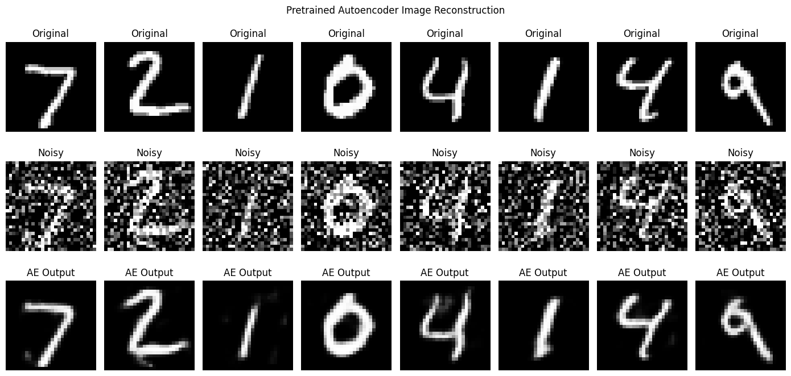
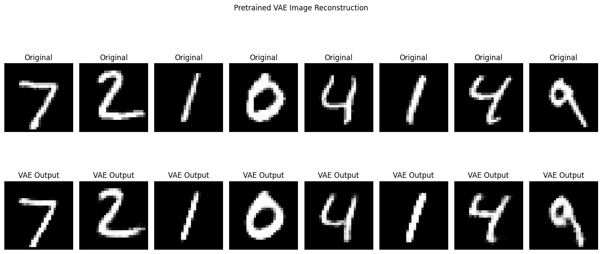
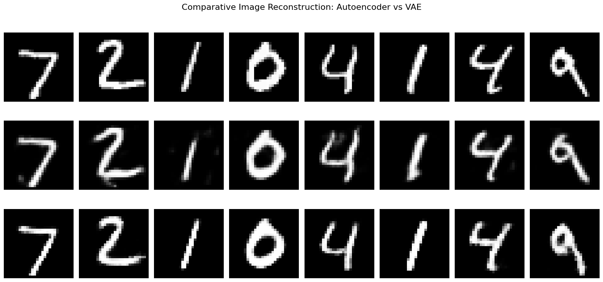
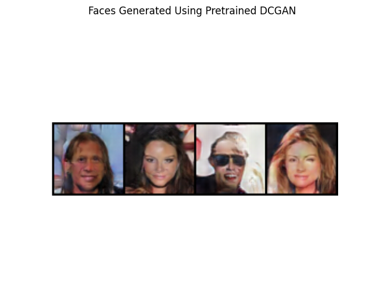
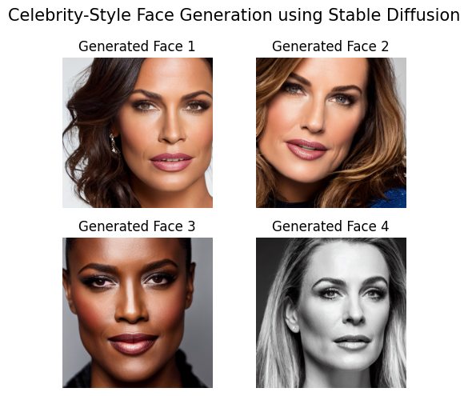
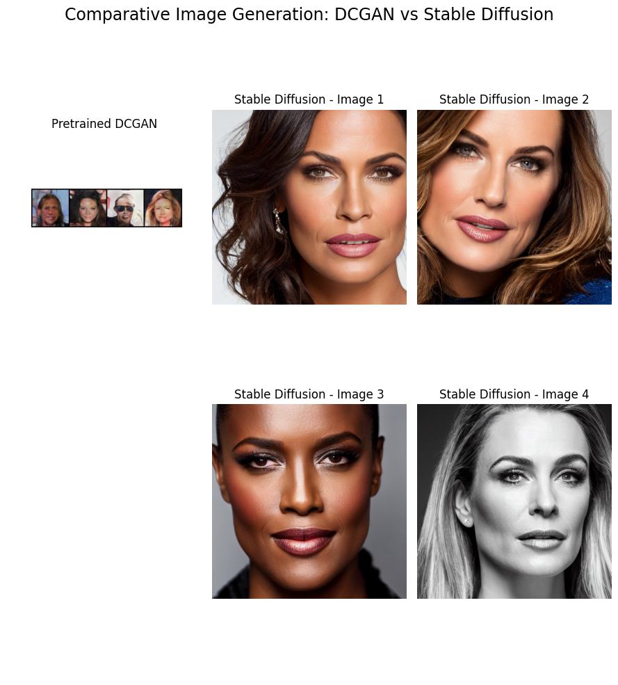

# Assignment – 02
## Comparative Study and Practical Analysis of Generative AI Models

**Topic:** Image Reconstruction and Image Generation  
**Subject:** Generative AI

---

## 1. Objective

To understand and analyse image reconstruction and image generation using four Generative AI models:

1. Autoencoder (AE)
2. Variational Autoencoder (VAE)
3. Deep Convolutional Generative Adversarial Network (DCGAN)
4. Pretrained Diffusion Model (Stable Diffusion)

The practical experiments were performed using pretrained models without training or fine-tuning.

## 2. Practical Setup and Methodology

Two activities were performed:

- **Activity A – Image Reconstruction (CO3):** Pretrained Autoencoder and VAE models were used to reconstruct MNIST testing images.
- **Activity B – Image Generation (CO4):** A pretrained CelebA DCGAN generator and Stable Diffusion 1.5 were used to generate face images.

For image reconstruction, eight MNIST testing images were selected. The Autoencoder received noisy images, while the VAE received binarized images.

For image generation, DCGAN generated four faces from random noise, and Stable Diffusion generated four fictional celebrity-style portraits using a text prompt.

---

# 3. Comparative Analysis of Autoencoder and VAE

| Comparison Aspect | Autoencoder (AE) | Variational Autoencoder (VAE) |
|---|---|---|
| Working Principle | Encodes input into a deterministic latent representation and reconstructs the image. | Encodes input into a probability distribution in latent space and reconstructs the image. |
| Architecture | Encoder, Latent Space, Decoder. | Encoder, Mean, Variance, Sampling, Decoder. |
| Latent Space | Deterministic representation. | Probabilistic representation. |
| Dataset | MNIST | Binarized MNIST |
| Input | Noisy testing images. | Binarized testing images. |
| Advantages | Useful for image reconstruction and denoising. | Learns a structured probabilistic latent space. |
| Limitations | May lose fine details during compression. | Reconstructed images may appear smoother or blurrier. |
| Applications | Image denoising, compression, feature extraction. | Image generation, representation learning, probabilistic modelling. |

## 3.1 Autoencoder – Practical Output

The pretrained convolutional Autoencoder was used to reconstruct noisy MNIST testing images.

The model removed a significant amount of noise while preserving the general shape of most digits. Some fine details were lost, and a few outputs appeared slightly blurred.

## 3.2 VAE – Practical Output

The pretrained MNIST VAE reconstructed binarized testing images using its probabilistic latent representation.

The reconstructed digits remained recognizable and generally showed smooth strokes.

## 3.3 AE vs VAE – Visual Comparison

The following comparison presents the original images, Autoencoder outputs and VAE outputs together.

### Observation

The Autoencoder focuses on deterministic reconstruction, whereas the VAE learns a probabilistic latent representation.

Both models successfully reconstructed the MNIST digits. However, their input preprocessing and original training objectives differ, so this is a qualitative rather than strictly controlled comparison.

---

# 4. Comparative Analysis of DCGAN and Diffusion Model

| Comparison Aspect | DCGAN | Stable Diffusion |
|---|---|---|
| Working Principle | Generator produces images while Discriminator distinguishes real and generated images. | Generates images through an iterative denoising process guided by text prompts. |
| Architecture | Generator and Discriminator. | Text Encoder, U-Net, Scheduler and VAE. |
| Input | Random latent noise. | Text prompt. |
| Model | Pretrained CelebA DCGAN. | Stable Diffusion 1.5. |
| Generation Type | Unconditional generation. | Text-conditioned generation. |
| Advantages | Generates images from random noise and demonstrates adversarial learning. | Produces detailed images with text-based control. |
| Limitations | Quality and diversity depend on training data and checkpoint. | Requires more computation and may produce artifacts. |
| Applications | Face generation, image synthesis, data augmentation. | Text-to-image generation, creative design, visual prototyping. |

## 4.1 DCGAN – Practical Output

The pretrained DCGAN generator checkpoint `celeba_netG.pth` was loaded.

Four face images were generated using random noise. No training or fine-tuning was performed.

## 4.2 Stable Diffusion – Practical Output

Stable Diffusion 1.5 was loaded as a pretrained model.

A text prompt describing a photorealistic, front-facing celebrity-style portrait was supplied to generate four images.

## 4.3 DCGAN vs Stable Diffusion – Visual Comparison

Both models generated human-face images, making the subject category similar.

DCGAN generated a four-face grid, whereas Stable Diffusion generated four individual prompt-conditioned portraits.

The Stable Diffusion examples appear higher in resolution and contain more visible facial details.

### Observation

DCGAN demonstrates adversarial image generation using random noise, whereas Stable Diffusion demonstrates text-conditioned image generation through iterative denoising.

Stable Diffusion provides greater control over the generated content through text prompts.

---

# 5. Overall Observations

| Model | Input | Experimental Observation |
|---|---|---|
| Autoencoder | Noisy MNIST images | Successfully removed noise and reconstructed digits. |
| VAE | Binarized MNIST images | Reconstructed recognizable digits using probabilistic latent representations. |
| DCGAN | Random latent noise | Generated human faces using a pretrained generator. |
| Stable Diffusion | Text prompts | Generated detailed celebrity-style portrait images. |

The experiments demonstrate the difference between reconstruction-oriented models and image-generation models.

Autoencoder and VAE reconstruct existing input images, while DCGAN and Diffusion models generate new images.

---

# 6. AI Tools Used and Verification

### AI Tools Used

- ChatGPT
- Google Colab
- Hugging Face
- TensorFlow/Keras
- PyTorch
- Diffusers
- Matplotlib

### Verification Process

1. Loaded pretrained models and checkpoints.
2. Verified successful model loading in Google Colab.
3. Used testing images for reconstruction.
4. Used random noise and text prompts for image generation.
5. Examined the generated and reconstructed outputs.
6. Compared the results visually.

---

# 7. Group Reflection and Learning Outcomes

The experiments helped understand the working principles and differences between four Generative AI models.

The following concepts were explored:

- Deterministic and probabilistic latent representations.
- Image reconstruction and denoising.
- Generator and Discriminator architecture.
- Adversarial learning.
- Diffusion-based image generation.
- Text-to-image generation.

The practical implementation demonstrated how pretrained models can be used for image reconstruction and generation without requiring additional training.

---

# 8. Conclusion

The assignment successfully demonstrated image reconstruction using pretrained Autoencoder and VAE models and image generation using pretrained DCGAN and Stable Diffusion models.

The reconstruction experiments showed how deterministic and probabilistic latent representations affect reconstructed images.

The generation experiments highlighted the difference between noise-driven adversarial generation and text-conditioned diffusion generation.

All four practical activities were performed using pretrained model weights without training or fine-tuning during the experiments.

---

# 9. References

1. Autoencoder – https://huggingface.co/keras-io/conv_autoencoder
2. VAE – https://huggingface.co/uday9k/Binarized_MNIST_VAE
3. DCGAN – https://github.com/shivamswarnkar/Image-Generator
4. Stable Diffusion – https://huggingface.co/stable-diffusion-v1-5/stable-diffusion-v1-5

---

# 10. Image Files Required

Keep all six images in the same folder as this Markdown file.

| No. | Filename |
|---|---|
| 1 | `AE_Reconstruction.png` |
| 2 | `VAE_Reconstruction.png` |
| 3 | `AE_VAE_Final_Comparison.png` |
| 4 | `DCGAN_4_Faces.png` |
| 5 | `Stable_Diffusion_4_Faces.png` |
| 6 | `DCGAN_vs_Stable_Diffusion.png` |

**Note:** The images use relative paths. Keep the filenames exactly as specified for the images to render correctly.