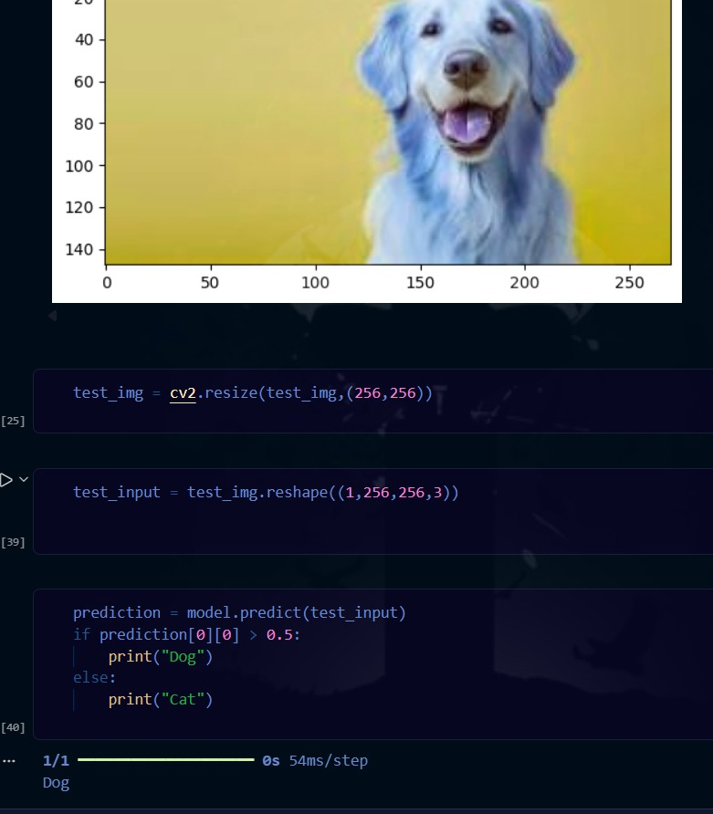

# Dogs vs Cats Image Classification using CNN

## 1. Project Overview

This project uses a **Convolutional Neural Network (CNN)** to classify images into two classes:

- Cat
- Dog

Dataset: **Dogs vs Cats — `salader/dogsvscats`**  
Kaggle: https://www.kaggle.com/datasets/salader/dogsvscats

### Workflow

```text
Kaggle Dataset
      ↓
Load Images
      ↓
Resize to 256 × 256
      ↓
Normalize (0–255 → 0–1)
      ↓
CNN
      ↓
Train
      ↓
Evaluate
      ↓
Predict Cat / Dog
```

---

## 2. Dataset

The dataset contains:

```text
Training images: 20,000
Testing images:   5,000
Classes:          2
```

Expected structure:

```text
Dataset/
├── train/
│   ├── cats/
│   └── dogs/
└── test/
    ├── cats/
    └── dogs/
```

---

## 3. Load Dataset

```python
import tensorflow as tf
from tensorflow import keras

train_ds = keras.utils.image_dataset_from_directory(
    '/content/train',
    labels='inferred',
    label_mode='int',
    batch_size=32,
    image_size=(256, 256)
)

test_ds = keras.utils.image_dataset_from_directory(
    '/content/test',
    labels='inferred',
    label_mode='int',
    batch_size=32,
    image_size=(256, 256)
)

print(train_ds.class_names)
```

---

## 4. Normalize Images

Images initially have pixel values from **0 to 255**.

They are converted to **0 to 1**:

```python
def process(image, label):
    image = tf.cast(image, tf.float32) / 255.0
    return image, label

train_ds = train_ds.map(process)
test_ds = test_ds.map(process)
```

---

## 5. CNN Model

```python
from keras import Sequential
from tensorflow.keras.layers import (
    Conv2D, MaxPooling2D, Flatten,
    Dense, BatchNormalization, Dropout
)

model = Sequential([
    Conv2D(32, kernel_size=(3,3),
           padding='valid',
           activation='relu',
           input_shape=(256,256,3)),
    BatchNormalization(),
    MaxPooling2D(pool_size=(2,2), strides=2),

    Conv2D(64, kernel_size=(3,3),
           padding='valid',
           activation='relu'),
    BatchNormalization(),
    MaxPooling2D(pool_size=(2,2), strides=2),

    Conv2D(128, kernel_size=(3,3),
           padding='valid',
           activation='relu'),
    BatchNormalization(),
    MaxPooling2D(pool_size=(2,2), strides=2),

    Flatten(),

    Dense(128, activation='relu'),
    Dropout(0.1),

    Dense(64, activation='relu'),
    Dropout(0.1),

    Dense(1, activation='sigmoid')
])
```

### Architecture

```text
Input: 256 × 256 × 3
        ↓
Conv2D(32)
        ↓
BatchNormalization
        ↓
MaxPooling
        ↓
Conv2D(64)
        ↓
BatchNormalization
        ↓
MaxPooling
        ↓
Conv2D(128)
        ↓
BatchNormalization
        ↓
MaxPooling
        ↓
Flatten
        ↓
Dense(128)
        ↓
Dropout
        ↓
Dense(64)
        ↓
Dropout
        ↓
Dense(1, Sigmoid)
        ↓
Cat / Dog
```

---

## 6. Compile and Train

```python
model.compile(
    optimizer='adam',
    loss='binary_crossentropy',
    metrics=['accuracy']
)

history = model.fit(
    train_ds,
    validation_data=test_ds,
    epochs=10
)
```

### Why these settings?

- **Adam** → optimizer used to update model weights.
- **Binary cross-entropy** → suitable for two-class classification.
- **Sigmoid** → produces a value between 0 and 1.
- **10 epochs** → the model sees the training dataset 10 times.
- **Batch size 32** → 32 images are processed at a time.

---

## 7. Training Result

The model achieved approximately:

```text
Training Accuracy:    97.27%
Validation Accuracy:  80.28%
```

The difference indicates that the model is showing some **overfitting**.

Possible improvements:

- Data augmentation
- Early stopping
- More dropout
- A more parameter-efficient architecture

---

## 8. Single Image Prediction

```python
import cv2
import numpy as np
import matplotlib.pyplot as plt

# Read image
test_img = cv2.imread('/content/dog.jpeg')

# Convert BGR → RGB
test_img = cv2.cvtColor(test_img, cv2.COLOR_BGR2RGB)

# Resize
test_img = cv2.resize(test_img, (256,256))

# Normalize
test_input = test_img.astype('float32') / 255.0

# Add batch dimension
test_input = np.expand_dims(test_input, axis=0)

# Predict
prediction = model.predict(test_input)

# Classify
if prediction[0][0] > 0.5:
    print("Dog")
else:
    print("Cat")
```

---

## 9. Prediction Output

For the test image used in the project, the model produced:

```text
1/1 ━━━━━━━━━━━━━━━━━━━━ 0s 54ms/step
Dog
```

The displayed image and output were:



### Interpretation

The model's sigmoid output was greater than `0.5`, so the image was classified as:

```text
Dog
```

The final prediction rule is:

```text
prediction > 0.5  → Dog
prediction ≤ 0.5  → Cat
```

> **Important:** The exact mapping of `0` and `1` should be checked with:
>
> ```python
> print(train_ds.class_names)
> ```

---

## 10. Data Augmentation

Data augmentation is not required for the basic model, but it can help reduce overfitting.

Example:

```python
data_augmentation = keras.Sequential([
    keras.layers.RandomFlip("horizontal"),
    keras.layers.RandomRotation(0.1),
    keras.layers.RandomZoom(0.1),
    keras.layers.RandomContrast(0.1)
])
```

It creates variations of training images without collecting new images.

---

## 11. GPU Training

In Google Colab, first enable:

**Runtime → Change runtime type → GPU**

Check whether TensorFlow can see the GPU:

```python
print(tf.config.list_physical_devices('GPU'))
```

If a GPU is detected, Keras will normally use it automatically for supported operations:

```python
history = model.fit(
    train_ds,
    validation_data=test_ds,
    epochs=10
)
```

---

## 12. Key Concepts

This project demonstrates:

- Image classification
- CNN
- Convolution
- Filters/kernels
- ReLU
- Max pooling
- Batch normalization
- Flatten
- Dense layers
- Dropout
- Sigmoid
- Binary cross-entropy
- Adam optimizer
- Epochs
- Batch size
- Image normalization
- Model training
- Model evaluation
- Single-image prediction
- Data augmentation
- GPU training
- Overfitting

---

## 13. Conclusion

The CNN successfully learns to classify images as **Cat** or **Dog**.

The model reached approximately **97.27% training accuracy** and **80.28% validation accuracy** after 10 epochs. The lower validation accuracy compared with training accuracy suggests overfitting.

Adding **data augmentation**, **early stopping**, and further regularization can improve generalization on unseen images.
